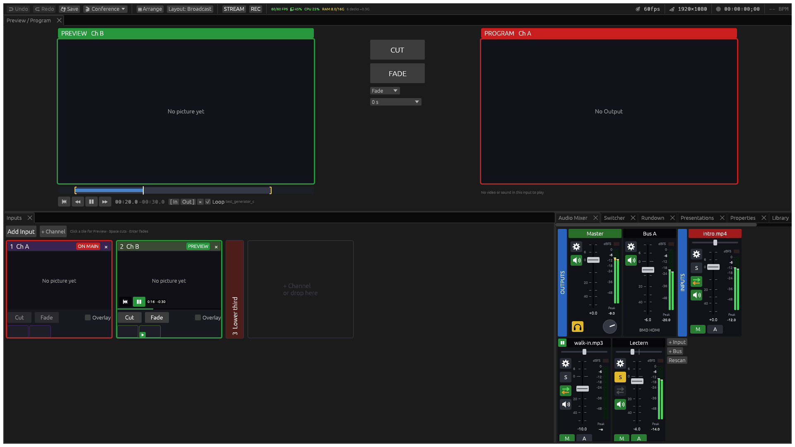

# Nida

**A live production switcher for conferences and events, on the Mac.** Cameras, slides, clips and remote speakers go through Preview and Program to the stage screens and LED walls, to recordings and to up to four streaming destinations at once, with an audio mixer for the room, the stream and the call.

If you have run shows on vMix, Nida will feel familiar: inputs built from layers, Preview and Program with Cut and Fade, overlays, an audio mixer with buses, and STREAM and REC buttons.



Nida is built on **[Varda](https://github.com/im-knots/varda)** by im-knots, a visual performance tool for VJs and installation artists, and keeps its MIT licence (see [LICENSE](LICENSE)). Varda's engine is still underneath: see [Underneath: Varda](#underneath-varda). Varda's community is on #varda at [Libera.Chat](https://web.libera.chat/#varda).

vMix and Resolume are trademarks of their owners. Nida is not affiliated with or endorsed by either; their names are used only to compare.

## Built for conferences and events

### Switching

- **Preview and Program**: in Main mode (**Main mode…** switches it on), one input is on air at a time. Click an input to put it in Preview; **Space** cuts it to Program and **Enter** takes it with the chosen transition.
- **Transitions**: Fade, **Merge**, Wipe, Slide, Zoom and Iris. Merge moves the layers two inputs share into their new places: a picture-in-picture grows to full screen, two speakers trade places, a speaker in a round bubble opens into the whole picture. Layers it cannot move (blended other than Normal, say, or in an input with effects of its own) fade across instead, and a notice says why.
- **Overlays**: a logo or a lower third stays on top of whatever is on air, with its own buttons to take it on and off.

### Inputs built from layers

- **Layers**: an input is a stack of them — a camera or capture card, a clip, a picture, NDI, a screen or window, a stream (SRT, RTMP, HLS), a colour, a web page (in builds with the web engine, not the DMG), or **another input**, drawn once and shown in both.
- **Per layer**: position, crop, colour correction, chroma and luma keys, flip and effects.
- **Borders**: colour, thickness and roundness. **Circle** puts a speaker in a ringed circle, the way podcasts show them.
- **Masks**: a rectangle, an ellipse or a shape drawn by hand, cut out of a layer, with feather and invert.
- **Layout templates**: side by side, top and bottom, picture-in-picture, 2 × 2. One click places the layers; then drag them to fine-tune.
- **Input Settings**: double-click an input to open them.

### Screens

- **Buses**: each screen in the room shows Main or a bus of its own — the stage screens, a confidence monitor, the stream.
- **LED screens**: several LED screens on one feed to the LED processor, each at its exact pixels, with a true-size test card.
- **Outputs**: Blackmagic UltraStudio and DeckLink devices (HDMI and SDI), and windows on any display — each at Full or Video levels.

### Streaming and recording

- **STREAM**: one encode, sent to up to **four RTMP or RTMPS destinations** at once — YouTube, a CDN, the client's own server.
  - H.264 or HEVC, on the Mac's media engine or in software, at a Constant, Variable or Average bit rate.
  - With the media engine, it can lower the bit rate by itself while the venue's upload cannot keep up.
  - When the network changes, a destination that stops getting through reconnects within seconds.
  - Live stats sit beside the button.
- **REC**: H.264, HEVC or ProRes 422 / 422 HQ. With the Hardware encoder (the default), the Mac's media engine encodes it wherever it has the codec, and recording costs almost no CPU.
  - MP4 files survive a crash: they are written in one-second pieces.
  - It records Main or any bus.
  - Files are named by the date and time they started.
  - It warns before the disk fills up.

### Sound

- **Audio mixer**: buses go to sound devices, recordings and streams, each with its own fader and delay. Solo and headphones too.
- **Clip sound**: it can follow its picture on and off air.
- **Sources with sound**: cameras and NDI sources bring their own sound, and NDI goes out with a bus of its own. One microphone can be delayed on its own, to line up with its picture.
- **Zoom and Teams calls**:
  - the call's sound comes straight from the app;
  - the guest's camera and slides come in as window inputs;
  - Nida's programme goes back to the call as a camera — through the free NDI Virtual Input, OBS's Virtual Camera or a USB capture device;
  - a bus made for the call (a mix-minus: everything but the call) keeps it from hearing itself.

### Running the show

- **Rundown**: the show as steps. A step changes every screen together, takes Main, and starts clips, playlists or timers, all with one press. **GO** takes the next step, or steps go on by themselves.
- **Timers**: count down, count up, count to a time, or show the time of day, on screen in their own font and colours. A countdown turns colour as it nears zero, and its control panel adds or takes off a minute or ten seconds.
- **Playlists**, and a clip transport under Preview with in and out points.
- **Screen layouts**: **Broadcast** (Preview and Program over the input tiles), **Classic** and **VJ**. Drag any panel and save your own.
- **Long days**: the Mac and its displays stay awake while Nida runs, and a show's files are written in the background, so the outputs never wait for the disk.

### Remote control, and an AI agent to set up the show

- **Everything over HTTP.** Inputs and their layers, Main and its transitions, the buses and screens, the audio mixer, STREAM, REC, timers and the rundown all have HTTP routes, and `POST /api/command` takes any of the engine's commands; a WebSocket sends the state as it changes. A control panel, a script or another program can run the show. The [HTTP API chapter](docs/13-api.md) has the recipes for a show, and every route is described in [docs/api/openapi.json](docs/api/openapi.json) (OpenAPI 3), and at `http://localhost:8080/api/docs` while Nida runs.
- **Your AI agent can set up a show.** Tell an AI agent that can run commands (a coding agent, say) what the event needs, and point it at the API: it can add the inputs, buses, stream destinations, recording and rundown, and save the show. See [Setting up a show with an AI agent](docs/13-api.md#setting-up-a-show-with-an-ai-agent). The API has no password, so keep Nida on a network you trust.

### Smooth, low-latency output

In the app (not in headless mode), Nida draws the show on a thread of its own, each frame started by the screen's refresh whenever the screen's rate fits the show's.

- **The control window does not hold up the screens.** A busy moment, an open menu or a dialog does not touch the outputs. Only reconfiguring a window (resizing it, or moving it to another screen) can cost them a frame or two.
- **A stalled screen stalls only itself.** Each output window shows its frames from a thread of its own, so a screen that macOS holds up costs that screen alone.
- **Cameras stay even.** Each picture is shown by when it was captured. Tick **Lowest latency** on a camera to show its newest picture every frame instead.
- **Low latency is the default.** Each frame is finished before the next one starts. **Normal** or **High** give a heavy 4K show on a laptop one or two frames of headroom.
- **Hardware does the heavy work.** Clips decode on the Mac's media engine when it has their codec (AV1 on M3 and newer), and with the Hardware encoder, recordings and streams are encoded there too, wherever it has the codec.
- **Hitches are counted.** macOS reports when each frame of Nida's windows came up on screen; Nida counts the hitches, and warns when an output display's refresh rate cannot show the show's frame rate evenly.

## Underneath: Varda

Varda's engine is still there: the routing matrix, ISF shaders and effect chains, modulation, projection mapping and edge blending, the arrangement timeline with SMPTE timecode, MIDI, OSC, and an HTTP API with a WebSocket. The VJ layout is laid out for it. The DMG leaves out web pages, depth sensors and face detection; a build from source with the default features has them. The [manual](docs/README.md) covers both.

## Buy me a coffee

Nida is free. If you find it useful, you can [buy me a coffee ☕](https://donate.stripe.com/4gM00j1Jqf9V9bl1xQ0RG00): it keeps me working on new updates. The link opens a Stripe page where you choose the amount. I use that one page for all my open-source projects, Nida among them; it was set up for my Lithuanian speech tools, so it says Kalamo.ai and names them.

Or scan it with your phone:

<a href="https://donate.stripe.com/4gM00j1Jqf9V9bl1xQ0RG00"></a>

## Install

### Download (macOS)

[Releases](https://github.com/kristijonasatpro/Nida/releases) have `Nida-<version>-macOS-arm64.dmg`, for Macs with Apple silicon and macOS Sequoia 15.7.9 or later. Open it and drag Nida to Applications. Nida is not signed by Apple, so the first time macOS says it cannot check it: open **System Settings → Privacy & Security** and click **Open Anyway** next to Nida — once. For NDI, install the free NDI runtime from [ndi.video](https://ndi.video) — the NDI SDK for Apple, or `brew install --cask libndi`.

The app carries its own FFmpeg (built with GPL parts), so the download as a whole is under the GPL version 3; the licences of everything inside are in `Nida.app/Contents/Resources/licenses`, and the exact source of every library inside is `Nida-<version>-third-party-source.tar.gz` beside the DMG. Nida's source stays MIT. A few of Varda's shaders, adapted from works whose licence is non-commercial or not stated, are left out of the download (they are in the source). `scripts/ci/build-macos.sh` makes the DMG, and the release workflow runs it for every `v*` tag.

### This computer (macOS)

Build the release and wrap it in an app, so it opens from the Finder or the Dock and macOS asks *Nida* for the camera, microphone, screen recording and local network:

```bash
cargo build --release --no-default-features --features screen-capture
scripts/make-local-app.sh --workspace ~/path/to/show --port 8080
open ~/Applications/Nida.app
```

The script puts `Nida.app` in `~/Applications`; its log is `~/Library/Logs/Nida/nida.log`.

So that macOS asks for the camera, microphone and so on only once, not after every build, make a signing certificate once: Keychain Access → **Certificate Assistant → Create a Certificate…**, name **Nida Local Signing**, Identity Type **Self Signed Root**, Certificate Type **Code Signing**. The script then signs every build with it (the first time, allow it to use the key: **Always Allow**). FFmpeg (`brew install ffmpeg-full`, for SRT; plain `ffmpeg` works without it) and, for NDI, the NDI runtime (`brew install --cask libndi`) are used from where Homebrew puts them.

### Upstream Varda releases

The [Varda releases](https://github.com/im-knots/varda/releases) (`Varda-macOS-universal.dmg`, `Varda-Linux-x86_64.tar.gz`, `Varda-Windows-x64.zip`) are the original project, without Nida's conference features.

## Getting Started
See the [manual](docs/README.md) for a complete guide to using Nida.

---

## Build from source

For bleeding edge features and bug fixes you can compile Nida from source.

Requires [Rust](https://rustup.rs/) (stable) and a GPU with Metal (macOS) or Vulkan (Linux) support.

Nida is made and tested on Macs with Apple silicon. The Linux build below is Varda's; Nida's own features have not been tested on Linux.

### Ubuntu / Debian

```bash
sudo apt install build-essential cmake pkg-config libvulkan-dev libavcodec-dev libavformat-dev libavutil-dev libswscale-dev libswresample-dev libavdevice-dev libsrt-gnutls-dev libasound2-dev libv4l-dev libfreenect-dev libpipewire-0.3-dev libshaderc-dev libwayland-dev libxkbcommon-dev libx11-dev libxrandr-dev libxi-dev libgtk-3-dev
```

`libpipewire-0.3-dev` (screen capture on Wayland) and `libfreenect-dev` (depth
sensors) back default-on features, so omitting them fails the build rather than
quietly disabling anything. Both are in Ubuntu's `universe` component — run
`sudo add-apt-repository universe` first if `apt` cannot find them.

```bash
cargo build --release
./target/release/varda
```

#### Optional: NDI
NDI is proprietary and not available via apt. To enable NDI send/receive:
```bash
wget https://downloads.ndi.tv/SDK/NDI_SDK_Linux/Install_NDI_SDK_v6_Linux.tar.gz
tar -xzf Install_NDI_SDK_v6_Linux.tar.gz
sudo ./Install_NDI_SDK_v6_Linux.sh
sudo cp -P NDI\ SDK\ for\ Linux/lib/x86_64-linux-gnu/* /usr/local/lib/
sudo ldconfig
```
Without it, NDI features are silently disabled

### macOS

```bash
# FFmpeg. The plain `brew install ffmpeg` has no SRT; `ffmpeg-full` has
# (keg-only, beside it). When it is installed, the build links it
# (.cargo/config.toml) and Nida runs its `ffmpeg` for REC and STREAM.
brew install ffmpeg-full

# Optional: NDI
brew install --cask libndi
```

```bash
cargo build --release
./target/release/varda
```

### Run from source

```
cargo run --release
```


## CLI flags

```
varda [OPTIONS]

    --headless                Run without main UI window (API-only control)
    --port <PORT>             HTTP API port [default: 8080]
    --fps <FPS>               Target render FPS in headless mode [default: 60]
    --workspace <DIR>         Workspace root directory [default: cwd]
    --scene <PATH>            Scene file to load
    --stage <PATH>            Stage file to load
    --osc-port <PORT>         OSC input port (overrides osc.json)
    --osc-out <HOST:PORT>     OSC feedback target (repeatable)
    --no-osc                  Disable OSC
    --no-ndi                  Disable NDI
    --no-syphon               Disable Syphon (macOS)
    --no-screen-capture       Disable screen / window capture sources
    --shader-dir <DIR>        Extra shader library directory (repeatable)
```

`--shader-dir` is repeatable and layers on top of the built-in shader directories in a fixed precedence order. see [Shader Authoring → File Location](docs/12-isf-authoring.md#file-location) for the full hierarchy and override/hot-reload behavior.

> **Shader format:** Nida uses ISF's JSON metadata header with GLSL 450 (Vulkan) shader bodies, not ISF's GLSL ES dialect. Shaders from isf.video need a short mechanical port — see [Porting an ISF Shader](docs/12-isf-authoring.md#porting-an-isf-shader).

Headless mode runs the full engine without a UI window — controlled via the HTTP API. Outputs defined in `stage.json` auto-start on launch. Graceful shutdown on Ctrl-C or `POST /api/shutdown`.

```bash
# Headless on custom port with 30fps render
varda --headless --port 9090 --fps 30

# Separate workspace per venue
varda --workspace /shows/festival-2026

# Disable subsystems you don't need
varda --no-ndi --no-syphon --osc-port 7000

# Pull in extra shader folders (repeatable) — e.g. a USB stick + a show pack
varda --shader-dir /media/usb/shaders --shader-dir /shows/festival-2026/shaders
```

## HTTP API

The GUI and HTTP API are co-equal consumers of the same engine. The API runs on port 8080 (configurable with `--port`) alongside the GUI, or standalone in headless mode (`--headless`). Interactive docs at `/api/docs`, OpenAPI spec at `/api/openapi.json` (also in this repository as [docs/api/openapi.json](docs/api/openapi.json)). WebSocket at `/api/ws` streams state via JSON Patch (RFC 6902) deltas. The [manual's chapter](docs/13-api.md) has recipes for running a show and for setting one up with an AI agent.


## Contributing

Bug reports, feature requests, and pull requests are welcome. See [CONTRIBUTING.md](CONTRIBUTING.md) for the architecture overview, engineering practices, PR workflow, and [benchmarking harness](CONTRIBUTING.md#benchmarking).

## License
[MIT](LICENSE) for Nida's source, as for Varda's. The DMG under Releases also holds FFmpeg and the libraries it uses, so it is given away under the [GPL version 3](https://www.gnu.org/licenses/gpl-3.0.html); see `Nida.app/Contents/Resources/licenses`.
