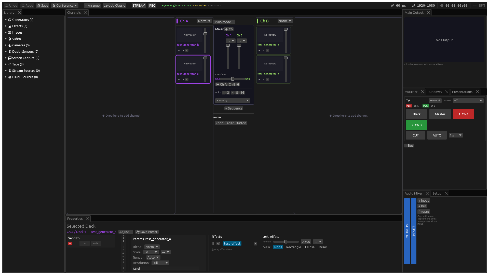

# Getting Started

## Install

The quickest way is the DMG under [Releases](https://github.com/kristijonasatpro/Nida/releases),
for Macs with Apple silicon: see [Download](../README.md#download-macos).

To build it yourself, on a Mac, build the release and wrap it in an app:

```bash
cargo build --release --no-default-features --features screen-capture
scripts/make-local-app.sh --workspace ~/path/to/show --port 8080
open ~/Applications/Nida.app
```

`Nida.app` opens from the Finder or the Dock like any Mac app. The first time,
macOS asks it for the microphone, the camera, files in folders such as
Downloads (where a show's media may be), screen recording and the local
network (NDI) — allow each. Its log is `~/Library/Logs/Nida/nida.log`.

The app is signed without a developer certificate, so after an update macOS
may ask again. The script's options set the API port, the show's workspace and
extra shader folders (`--shader-dir`); run it again after each build.

Nida is built on [Varda](https://github.com/im-knots/varda); Varda's own
releases are the original project, without Nida's conference features.

## Workspace & Content

Nida treats the current directory (or `--workspace` path) as the workspace root. Create a project folder and put your content in it:

```
my-show/
  shaders/       ← ISF shader files (.fs) — auto-discovered, hot-reloaded on save
  media/         ← videos and images (loaded via Library panel)
  .varda/        ← created automatically (scene, stage, presets, mappings, OSC config)
```

Shaders in `shaders/` appear automatically in the Library panel under **Generators**, **Effects**, or **Transitions** based on their type. Videos and images are loaded through the Library panel's file browser.

**Supported formats:**

| Type | Formats |
|------|---------|
| **Shaders** | `.fs` (ISF GLSL 450) |
| **Video** | Any ffmpeg-supported container/codec — MP4, MOV, MKV, AVI, WebM (H.264, H.265, ProRes, VP9, etc.) |
| **HAP Video** | MOV with HAP, HAP Alpha, HAP Q, HAP Q Alpha, HAP R — GPU-native decode, no CPU overhead |
| **Images** | PNG, JPG/JPEG, BMP, TIFF, TGA, WebP |
| **Vector** | SVG/SVGZ — redrawn at your render resolution, so it stays sharp at any size |

The table above covers local file content. Nida can also route live and network inputs like cameras, NDI, SRT, HLS, DASH, RTMP, screen and window captures, compute shaders, and more. See [Source Types](02-concepts.md#source-types) for the complete list.

## Build from Source

Requires FFmpeg **9 or newer** (commands and development libraries), [Rust](https://rustup.rs/) (stable) and a GPU with Metal (macOS), Vulkan (Linux), or DirectX 12 (Windows) support.

### Ubuntu / Debian

```bash
sudo apt install build-essential cmake pkg-config libvulkan-dev python3 libclang-dev libsrt-gnutls-dev libasound2-dev libv4l-dev libfreenect-dev libpipewire-0.3-dev libshaderc-dev libwayland-dev libxkbcommon-dev libx11-dev libxrandr-dev libxi-dev libgtk-3-dev
```

Ubuntu 24.04's standard FFmpeg is 6.1, which is too old for the frame-reuse
APIs used here. On Linux x86_64, install the same FFmpeg 9 shared SDK selected
in CI, without replacing system libraries:

```bash
python3 scripts/ci/setup-linux-ffmpeg.py
source "$HOME/.local/nida-ffmpeg-9/nida-env.sh"
ffmpeg -version
pkg-config --modversion libavcodec  # 63.x for FFmpeg 9
```

The helper verifies the archive's published SHA256, selects matching binaries,
headers and shared libraries, and compiles/runs a check of the required frame
side-data API. It records the exact download and checksum in
`nida-build-inputs.json`. CI caches by that checksum. This SDK enables GPL
codecs, like the Windows SDK. Other Linux architectures need a native FFmpeg
9+ build and matching development libraries; this helper is x86_64-only.
Re-source `nida-env.sh` in each new build/run shell. For a portable Linux package,
`scripts/ci/build-linux.sh` bundles this SDK's commands, libraries and licence.

Two of those back default-on features and are easy to miss, because leaving them
out fails the build rather than disabling the feature: `libpipewire-0.3-dev` is
resolved through `pkg-config` by the `screen-capture` Wayland backend, and
`libfreenect-dev` provides the `-lfreenect` the `depth` feature links against.
Both live in Ubuntu's `universe` component — run `sudo add-apt-repository
universe` first if `apt` cannot find them.

```bash
cargo build --release
./target/release/varda
```

### macOS

```bash
brew tap homebrew-ffmpeg/ffmpeg
brew install homebrew-ffmpeg/ffmpeg/ffmpeg --with-srt
pkg-config --atleast-version=63 libavcodec  # FFmpeg 9+

# Depth-sensor support (the default-on `depth` feature)
brew install libfreenect
```

```bash
# Homebrew's lib directory is not on the linker's default search path, and
# libfreenect's crate does not emit one. Without this the build fails at link
# time with: ld: library 'freenect' not found
export LIBRARY_PATH=/opt/homebrew/lib      # Apple Silicon
# export LIBRARY_PATH=/usr/local/lib       # Intel

cargo build --release
./target/release/varda
```

Prefer `LIBRARY_PATH` over adding `-L` to `RUSTFLAGS`: changing `RUSTFLAGS`
invalidates the whole build cache, and this project has a heavy dependency tree.

To build without depth-sensor support instead, drop the feature:

```bash
cargo build --release --no-default-features --features face-detection,html,screen-capture
```

### Run from source

```sh
cargo run --release
```

## UI Layout



- **Top bar** — undo, redo, save and the **🎬** show menu (New, Open, Save As) on the left, then **Arrange**, **Layout**, **STREAM**, **REC** — while live, each with its figures beside it, as OBS's status bar shows them — and the live performance metrics (frame rate against its target, `50/50 FPS`, GPU, CPU, RAM). On the right, reading right to left: the **BPM / clock** readout, the **transport position** as timecode, the **📐 render resolution**, and the **🎯 target frame rate**. Each one is clickable and opens its settings.
- Below it, **panels** as tabs, arranged by the screen layout — **Classic** (shown), **Broadcast**, **VJ** or your own. See [Screen Layouts](20-layouts.md).

In the Classic layout:

- **Library** (left, toggle with **L**) — content browser: shaders, video, images, cameras, screen capture targets, taps, NDI, SRT, HLS/DASH sources, and presets. See [Library Panel](03-library-panel.md).
- **Channels** (center) — channel/deck grid with mixer crossfader. Toggle to **Stage Editor** for surface drawing.
- **Main Output**, **Switcher** (the **Rundown** a tab behind it), **Audio Mixer** and **Setup** (right) — the output picture, the buses, the show's steps in order (see [Rundown](25-rundown.md)), the sound, and in Setup: **🎨 Tonemap** (curve and 3D LUT), **〰 Modulation**, **🎹 MIDI**, **🗺 Stage Layout**, and **📺 Outputs**.
- **Properties** (under the channels) — context-sensitive: shows the selected deck's parameters, effect chains, or sequence editor

Drag a divider to resize; drag a panel's tab to move it anywhere.

## Load Content

1. Open the **Library** panel (press **L** to toggle)
2. Browse the **Generators** section for ISF shaders
3. **Drag** a shader from the library into a channel column — a new deck is created

The shader renders immediately in the deck's preview thumbnail and the main output.

To load **video or images**, use the Video or Image sections in the Library — a file browser opens to select files from your workspace.

### Drop files in from Finder

Drag images, videos, ISF shaders (`.fs`) or whole folders from Finder onto the
Nida window. While you drag, the place they will land is highlighted with a
label such as **2 images, 1 video → Ch B**:

- over a **channel column** — they become decks in that channel, placed where
  the blue line shows: before the card whose upper half you are over, or after
  the last card;
- over **Drop here to add channel** — a new channel is made for them;
- anywhere else — they go to the selected channel (the first channel if none
  is selected).

Deck cards move the same way: drag a card within its channel or into another
channel, and it lands at the line — between two cards, at the top, or at the
end. Generators dragged from the Library do too.

Several files arrive in the order they were dropped, and a folder adds the
files directly inside it sorted the way Finder sorts them (slide 2 before
slide 10), so a folder of numbered speaker slides lands in order. Files Nida
cannot use (PDFs, documents, audio-only files) are skipped and named in a
notification. Each new deck gets crop and transform, like any other.

Pointing at a channel while dragging needs macOS; on Linux, dropped files go
to the selected channel.

### Adjusting a deck against the result

Selecting a deck or a channel fills the **bottom bar**. Its left-hand preview
always shows the **channel's result** — every deck in it composited — so a
change to any deck is judged against the picture it ends up in, whichever deck
is selected.

Beside that preview, **Send to** lists every bus with **Cut** and **Fade**
buttons for the channel: the right-click "Cut to / Fade to" menu, always open.
Cut puts the channel on that bus now; Fade takes it with the bus's AUTO time.
A bus name is **red** where the channel is on air and **green** where it waits
on Preview; a bus already showing it has both buttons greyed out.

To work on one deck, **double-click its card** (or right-click it →
**Adjust…**, or **Adjust…** in the bottom bar). Its channel's **Input
Settings** window opens with that deck — that layer — picked: the channel's
result and its layers down the left, and on the right a preview to drag the
layer on (Shift-drag or scroll to resize) with its Position, Colour, Key and
Effects. Double-clicking a channel's name opens the same window on the whole
channel. See [Input Settings](21-input-settings.md).

## Main mode

For live events, switch to **Main mode…** (top of the mixer's centre
column): one channel on air at a time, the way vMix works — select it, **Space** cuts, **Enter**
fades — with overlay channels on top, the channels in one wide row, and
**+ Channel** to add one. See [Main mode](18-main.md).

## Add a Second Channel

1. Drag another shader into the second channel column
2. Use the **crossfader** in the mixer box to blend between Channel A and Channel B
3. Click the **auto-transition** button for timed or beat-synced crossfades
4. Select a **transition shader** (dissolve, iris, push, etc.) from the dropdown

## Apply Effects

1. In the library, switch to the **Effects** section
2. Drag an effect onto a deck, channel, or the master output
3. Select the deck or effect to see its parameters in the **bottom bar**
4. Adjust parameters with sliders — all are MIDI/OSC-mappable and modulatable

## Output to a Display

1. In the **Setup** panel, open the **📺 Outputs** section and click **"+ Windowed"** to create a new output window
2. A floating window appears — this is your output
3. In the output settings, select a **display target** (enumerate monitors from the dropdown)
4. Click **Fullscreen** to send the output to the selected projector or display

For rotation, source routing, and multi-output recording, see [Outputs](07-outputs.md).

## Audio Reactivity

Nida analyzes audio input for beat detection and frequency-band modulation. To get started:

1. In the **modulation panel** (right sidebar), add an **Audio** modulation source
2. In the source's **device dropdown**, select the audio input receiving your music feed (line-in, USB interface, etc.)
3. Choose a **frequency preset** — Low (bass), Mid, or High (treble) — or set a custom Hz range
4. Assign the source to any parameter (opacity, shader param, etc.) — it now reacts to the music

Beat detection activates automatically from the audio input — BPM appears in the top bar and drives beat-synced transitions and auto-crossfades.

ISF shaders also receive audio data directly via built-in uniforms (`audio_bass`, `audio_mid`, `audio_treble`, `audio_bpm`, `audio_beat_phase`) — no modulation setup needed. See [Modulation & Audio Reactivity](05-modulation.md) for the full guide.

## Next Steps

Once you have content playing on a display, explore deeper capabilities:

- **[Performance & Automation](04-performance.md)** — video playback controls, deck auto-transitions, transition sequences, undo/redo, presets
- **[Modulation & Audio Reactivity](05-modulation.md)** — LFO, audio bands, ADSR, step sequencer, mod-on-mod chaining
- **[Control Surfaces](06-control-surfaces.md)** — MIDI learn, OSC, keyboard shortcuts, clock sync
- **[Projection Mapping](08-projection.md)** — surfaces, corner-pin warp, multi-projector edge blending, dome projection
- **[Outputs](07-outputs.md)** — display targets, rotation, source routing, multi-output recording
- **[Streaming & I/O](09-streaming-and-io.md)** — NDI, SRT, HLS/DASH, recording
- **[ISF Shader Authoring](12-isf-authoring.md)** — write your own generators, filters, and transitions
- **[HTTP API](13-api.md)** — REST/WebSocket control, headless mode

## Save Your Work

Press **Cmd+S** or click the **💾 Save** button to save the current state. Nida persists:

- `scene.json` — your show (channels, decks, effects, modulation)
- `stage.json` — the venue (surfaces, outputs, warp calibration)
- `midi.json` — controller mappings
- `keymap.json` — keyboard shortcuts

Nida also saves the show whenever it closes — its window closed, or Quit
(⌘Q, or Quit in the Dock).

Saving on air is safe: the show's files are written on a thread of their
own, so the outputs, the stream and the recording carry on while they are
written — **💾 “show” saved** says when they are there. (A nearly full disk
once took half a second over one small file, and every output stood still
that long.) **Save As** is copied the same way: the show carries on in the
folder it was saved from until the copy is there, then moves to the new one
— **💾 Saved as “name”** — and whatever you save meanwhile goes into the new
show, not the old. A preset, a saved layout and the Recent list are written
on that thread too.

### Shows: New, Open, Save As

A show is a folder (holding `.varda/`), like one of vMix's presets. The
**🎬** menu beside **💾 Save** is named after the show open:

- **New show** — a fresh show, as one never set up: two empty inputs,
  nothing on Main, no outputs (their windows close), the one bus, the sound
  mixer's Master with no inputs, and the stream, recording and timecode
  settings as new. The show open is saved first, and the new one gets a
  folder of its own — **Untitled** (then Untitled 2, …) in `Documents/Nida
  Shows` — so it can never be saved over the one before. What belongs to the
  desk comes along: MIDI mappings, keys, OSC, the presets, LUTs and shaders;
  the size and frame rate stay. It asks before it starts.
- **Open…** — pick a show's folder. The show open is saved first. The
  show's screens that are already open stay up as they are (not opened
  twice), and screens it does not have close; a show made at another size
  switches Nida to that size.
- **Open recent** — the shows opened lately.
- **Save As…** — save the show under a new name (a new folder, or an empty
  one) and carry on in it; its presets, LUTs and shaders go with it. The
  show it was before stays as it was. One at a time: a second Save As asked
  for before the first is there is refused — ask again a moment later.
- **Show in Finder** — the show's folder.

New and Open are greyed out while the stream or a recording is running:
opening another show would stop them. Nida opens the show it had open last
— unless `--workspace` on the command line names one.

## CLI Flags

```
varda [OPTIONS]

    --headless              Run without UI window (API-only control)
    --port <PORT>           HTTP API port (default: 8080)
    --fps <FPS>             Target render FPS in headless mode (default: 60)
    --workspace <DIR>       Workspace root directory (default: current directory)
    --scene <PATH>          Scene file to load (default: .varda/scene.json)
    --stage <PATH>          Stage file to load (default: .varda/stage.json)
    --osc-port <PORT>       OSC input port (overrides osc.json config)
    --osc-out <HOST:PORT>   OSC feedback target (repeatable)
    --no-osc                Disable OSC input
    --no-ndi                Disable NDI discovery and sending
    --no-syphon             Disable Syphon (macOS only)
    --no-html               Disable HTML deck sources (skips Servo rendering)
    --no-screen-capture     Disable screen / window capture deck sources
                            (no Screen Recording permission is ever requested)
```

CLI flags override persisted config for that session without modifying the saved files.

---

[Home](README.md) · [Next: Core Concepts →](02-concepts.md)
